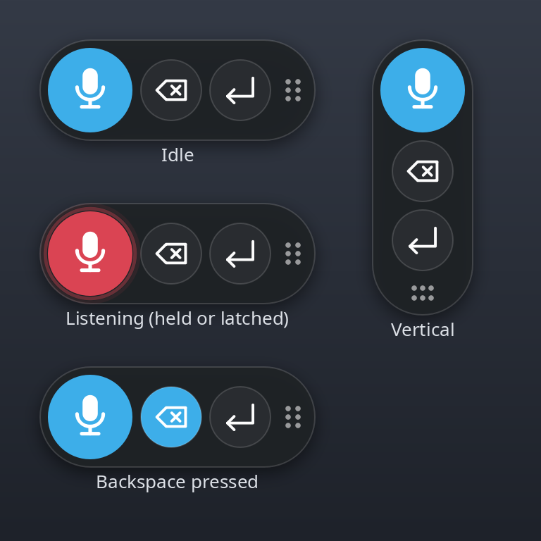
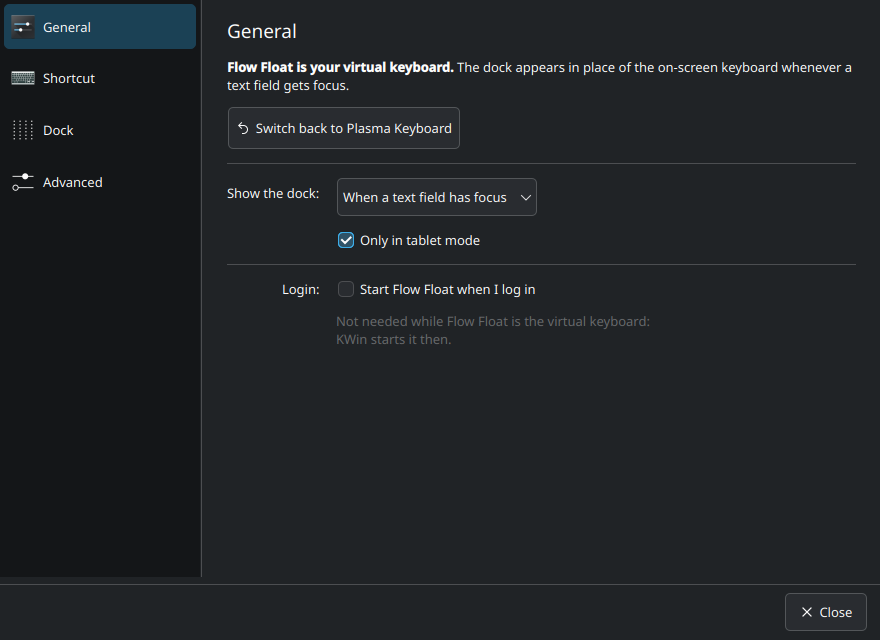
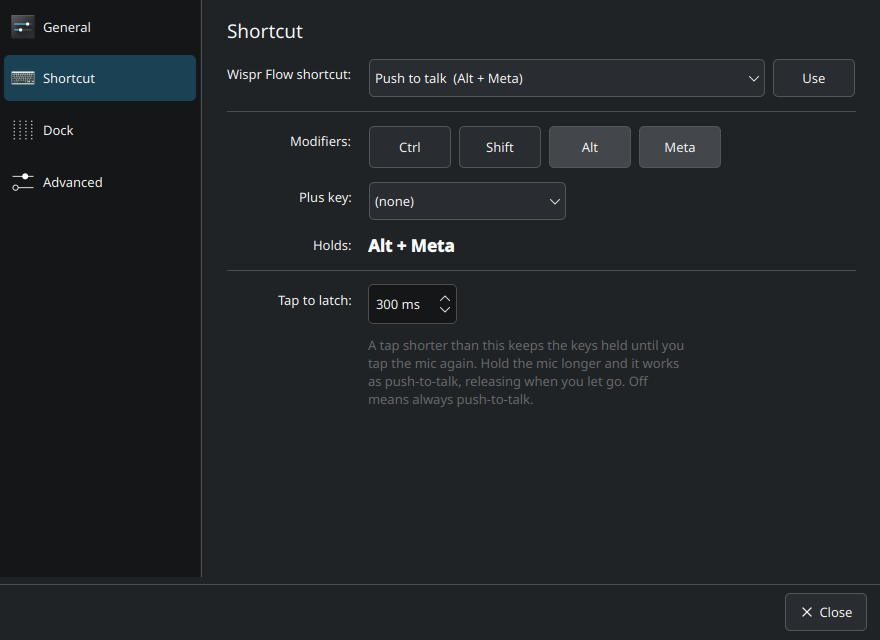
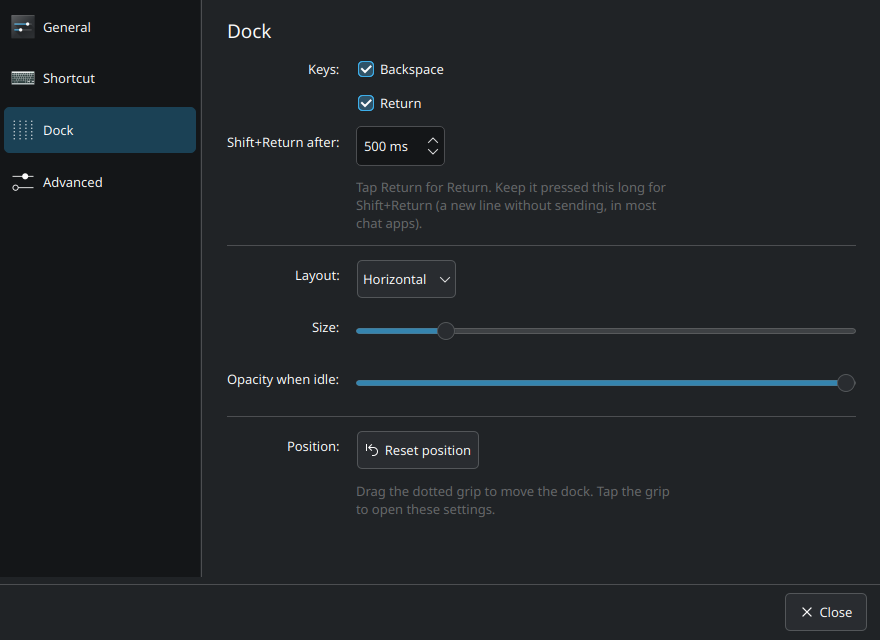

# Flow Float

> [!NOTE]
> This is a vibe-coded project, written with an AI coding assistant and tested only on one machine. It is provided as is, without any warranty or support: use it at your own risk. The author takes no responsibility for anything it does to your system.

<p align="center">
  
</p>

<p align="center">
  
</p>

<table>
  <tr>
    <td></td>
    <td></td>
    <td></td>
  </tr>
  <tr>
    <td align="center">General</td>
    <td align="center">Shortcut</td>
    <td align="center">Dock</td>
  </tr>
</table>

A floating push-to-talk dock for [Wispr Flow](https://wisprflow.ai) on KDE Plasma (Wayland), for when there's no keyboard, e.g. a convertible in tablet mode.

Flow Float takes over KDE's **virtual keyboard** slot. Whenever a text field gets focus, you get a small dock instead of the on-screen keyboard:

- **Mic button**: hold it to hold Wispr Flow's push-to-talk shortcut (Alt+Meta by default, read from Wispr's config). A quick tap (shorter than the latch delay, 300 ms by default) latches the keys down until your next tap, for hands-free dictation.
- **Backspace** and **Return**: two smaller buttons in line with the mic. Backspace repeats while held. Tap Return for Return, or long-press it for Shift+Return (a new line without sending, in most chat apps).
- **Grip**: drag it to move the dock, or tap it to open the settings.

The dock never takes keyboard focus. It's a layer-shell overlay, so the text field you're dictating into stays focused.

## Install

```bash
./install.sh
```

The script checks dependencies (Python 3.9+, `python3-pyside6`, `python3-evdev`, `layer-shell-qt`), installs `~/.local/share/applications/flow-float.desktop` and points KWin's virtual keyboard at it. The desktop file points at this checkout, so run `./install.sh` again if you move the folder. You can also pick it by hand under *System Settings → Keyboard → Virtual Keyboard → Flow Float*. KWin starts and stops Flow Float itself from then on.

To go back to the normal on-screen keyboard, use *Switch back to Plasma Keyboard* in the settings or the tray menu. To remove Flow Float completely, which restores the previous keyboard and deletes the desktop files, run:

```bash
./install.sh --uninstall
```

## Settings

Open the settings by tapping the dock's grip, clicking the tray icon, or running `./flow-float --settings`. You can change:

- the key combination (pick one of Wispr Flow's shortcuts or build your own)
- the latch delay (how short a tap must be to latch; Off = always push-to-talk)
- which keys the dock shows, its layout (vertical or horizontal), size and opacity
- whether the dock appears only in tablet mode (on by default; ignored on devices without a tablet mode)
- start at login. Only needed if you use "Always" without making Flow Float the virtual keyboard.
- a safety limit (Advanced, 5 minutes by default) after which held or latched keys are released, with a notification

The settings window has four pages: General, Shortcut, Dock and Advanced. Settings are stored in `~/.config/flowfloat/flowfloat.conf`, and the log is in `~/.cache/flowfloat/flowfloat.log`.

## How keys reach Wispr Flow

Wispr Flow's helper reads `/dev/input/event*` directly. Flow Float sends the shortcut through its own uinput virtual keyboard when the helper is reading that device. Otherwise it writes the events into a keyboard device the helper already has open, because the helper doesn't always notice devices that appear after it started. Backspace and Return always go through the virtual keyboard, so KWin delivers them to the focused app.

## Limitations

- The dock only appears for apps that use Wayland text input: Qt, GTK and Firefox do. Chromium and Electron apps (Chrome, Slack, VS Code…) need `--enable-wayland-ime` to report text focus, which is the same limitation Plasma's own keyboard has. For those, set *Show the dock* to *Always*.
- While Flow Float is the virtual keyboard there is no on-screen keyboard for typing.

## Development

```bash
pip install pytest ruff
pytest      # runs without a display
ruff check .
```

## License

MIT, see [LICENSE](LICENSE).
